# MEGA RACE 3D — Turbo Edition

Гонка с трансформирующимся транспортом на C++ и raylib. Весь код — один файл `main.cpp`,
все текстуры, модели, музыка и звуки создаются кодом при запуске. Никаких внешних ассетов,
кроме шрифта для русских букв.

Машина, танк, робот и карт превращаются в катер на воде и в самолёт в зонах взлёта.
Шесть трасс, шесть режимов, карьера из 20 этапов с боссами, игра вдвоём на одном экране.

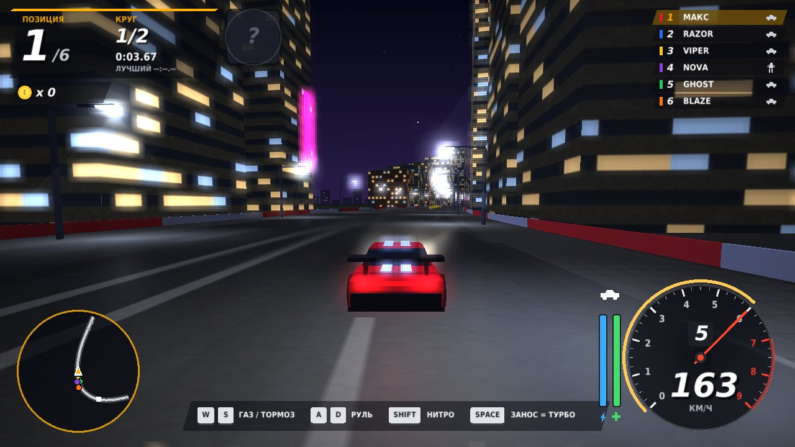

---

## Содержание

- [Что это](#что-это)
- [Скриншоты](#скриншоты)
- [Как запустить](#как-запустить)
- [Управление](#управление)
- [Режимы](#режимы)
- [Трассы](#трассы)
- [Как устроен код](#как-устроен-код)
- [Планы](#планы)
- [Лицензия](#лицензия)

---

## Что это

Смесь уличных гонок в духе Need for Speed и картинга в духе Mario Kart: нитро и полиция
соседствуют с коробками предметов, монетками и мини-турбо в заносах.

Главная особенность — трансформация. Трасса размечена зонами: на синих воротах транспорт
становится катером, на фиолетовых взлетает самолётом, на оранжевых снова едет по земле.
У каждого из четырёх видов транспорта своё поведение в каждой из трёх стихий.

| | Машина | Танк | Робот | Карт |
|---|---|---|---|---|
| Скорость | высокая | низкая | средняя | средняя |
| Разгон | средний | низкий | высокий | средний |
| Управление | цепкая | тяжёлое | вёрткое | лучшее |
| Броня | средняя | максимальная | выше средней | низкая |
| Особенность | занос = турбо | выстрел из пушки, ломает срезки | прыжок, шаг вбок, рывок | мини-турбо в заносах |

---

## Скриншоты

<table>
<tr>
<td width="50%">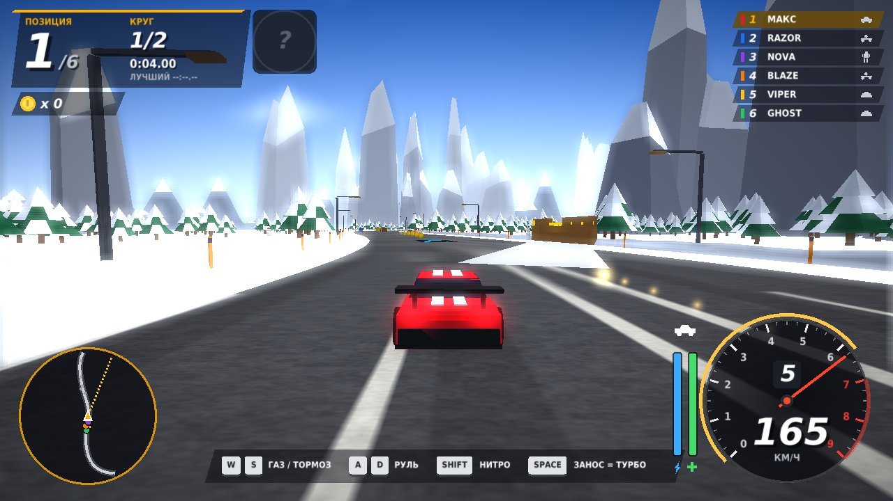<br><b>Ледяной перевал</b> — скользкое озеро и полёт над пиками</td>
<td width="50%">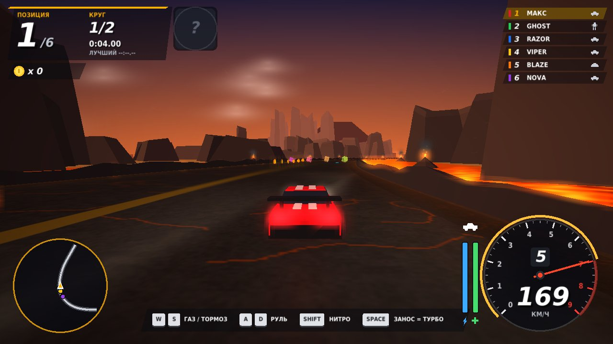<br><b>Вулкан</b> — лава и падающие с неба лавовые бомбы</td>
</tr>
<tr>
<td>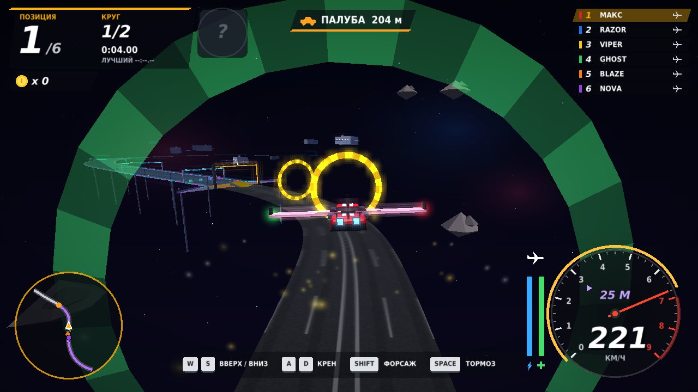<br><b>Орбита</b> — ховеркары, низкая гравитация, открытый космос</td>
<td>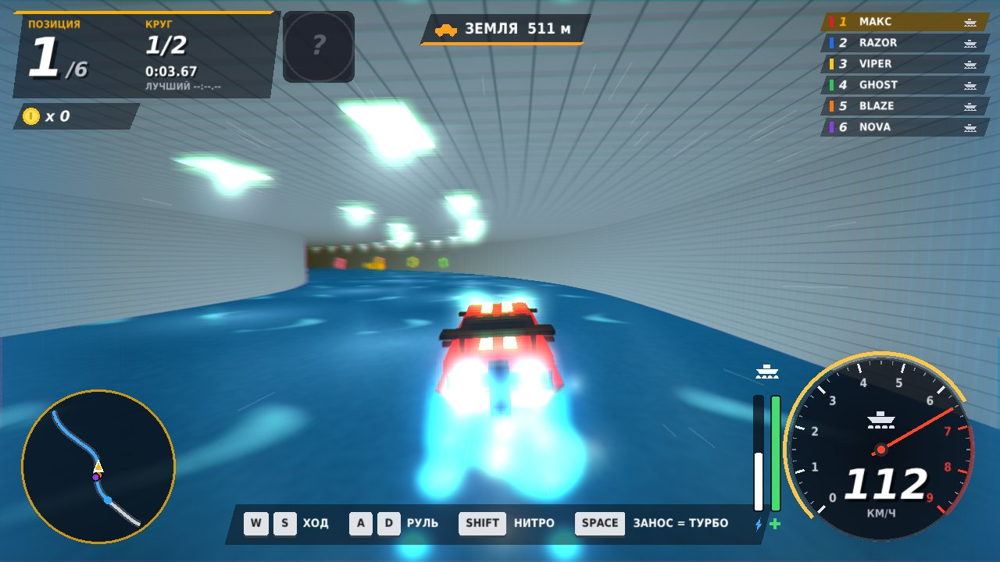<br><b>Закулисье</b> — секретная трасса, открывается в карьере</td>
</tr>
<tr>
<td>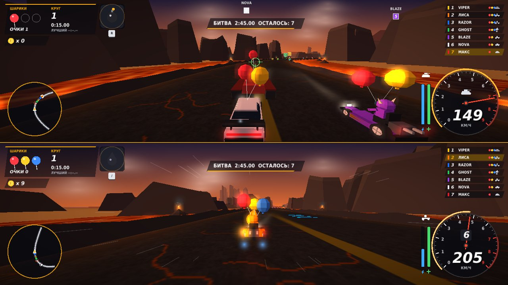<br><b>Игра вдвоём</b> — экран делится пополам</td>
<td>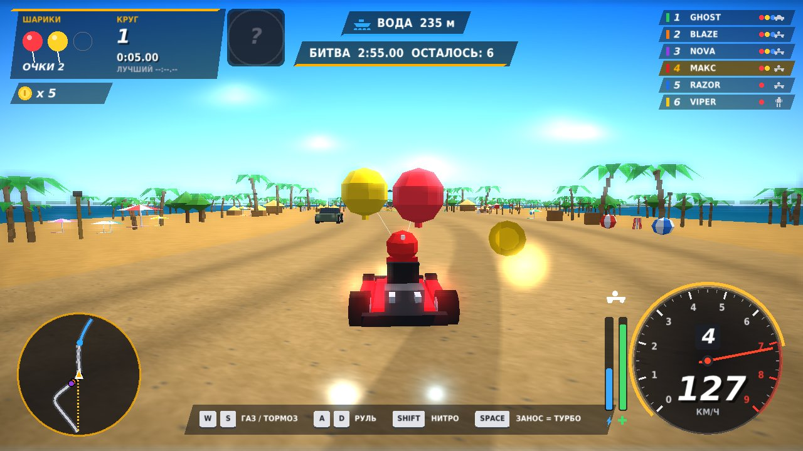<br><b>Битва</b> — сбивайте шарики соперников</td>
</tr>
<tr>
<td>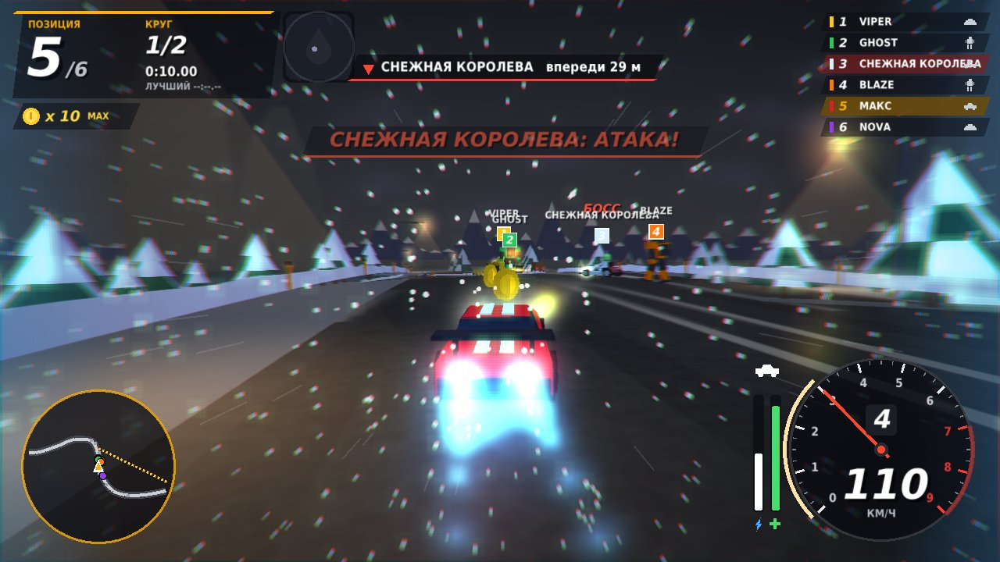<br><b>Боссы</b> — у каждого своя атака</td>
<td>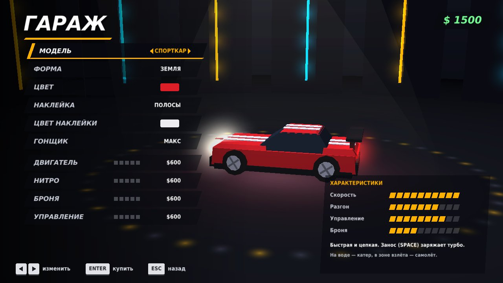<br><b>Гараж</b> — краски, наклейки, гонщики, прокачка</td>
</tr>
<tr>
<td>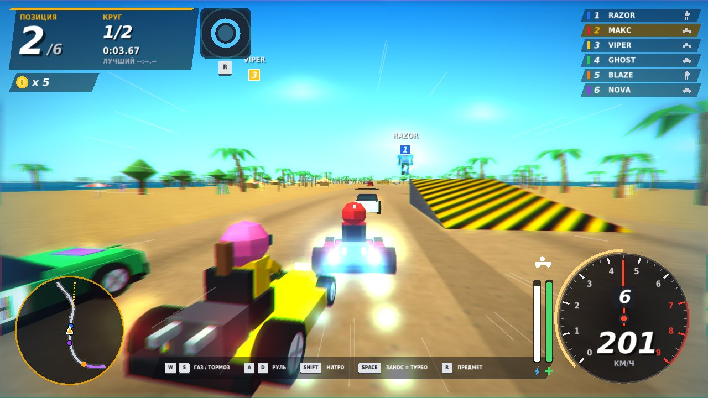<br><b>Солнечный пляж</b></td>
<td>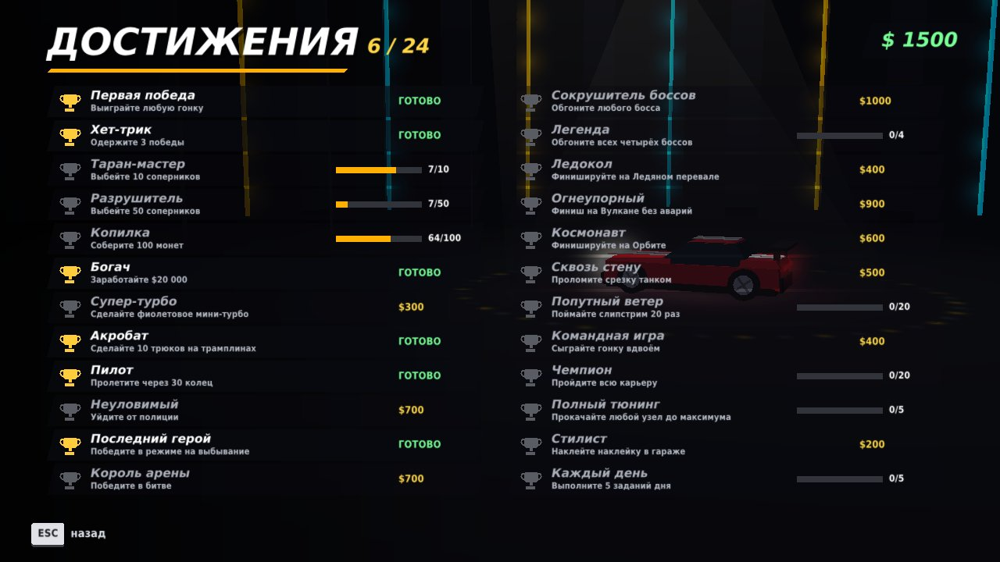<br><b>24 достижения</b> с денежными наградами</td>
</tr>
</table>

---

## Как запустить

Нужен компилятор с поддержкой C++17 и raylib 5.5.
С raylib 5.0 тоже соберётся, но без вибрации геймпада.

### Windows, Visual Studio 2022 (проще всего)

raylib скачается сам, ставить ничего не нужно.

1. В Visual Studio Installer убедитесь, что установлен компонент
   **«Разработка классических приложений на C++»**.
2. Скачайте этот репозиторий: зелёная кнопка **Code** → **Download ZIP** → распакуйте.
3. В Visual Studio: **Файл → Открыть → Папку** и выберите папку с `CMakeLists.txt`.
   Не «Открыть проект или решение» — файла `.sln` здесь нет.
4. Дождитесь внизу строки **«Создание CMake завершено»**. Первый раз это занимает
   1–3 минуты, потому что скачивается raylib. Нужен интернет.
5. В списке конфигураций вверху выберите **release**, рядом в списке запуска —
   **MegaRace.exe**.
6. Нажмите **Ctrl+F5**.

### Windows, raylib installer

Если raylib установлен в `C:\raylib`, просто запустите `build.bat`.

### Linux

```bash
sudo apt install build-essential cmake libasound2-dev libx11-dev libxrandr-dev \
                 libxi-dev libgl1-mesa-dev libglu1-mesa-dev libxcursor-dev libxinerama-dev
cmake -B build -DCMAKE_BUILD_TYPE=Release
cmake --build build -j
./build/MegaRace
```

### Свой проект

Возьмите `main.cpp` и подключите raylib. Папки `assets` и `music` положите
рядом с исполняемым файлом.

```bash
g++ main.cpp -o MegaRace -O2 -std=c++17 -lraylib -lGL -lm -lpthread -ldl -lrt -lX11
```

**Файлы рядом с игрой:** `megarace_save.txt` — прогресс, `megarace_ghost_N.bin` — призраки
для режима на время, `MegaRace_photo_NNN.png` — снимки из фоторежима.

---

## Управление

| Действие | Игрок 1 | Игрок 2 | Геймпад |
|---|---|---|---|
| Газ / тормоз (в воздухе вверх / вниз) | `W` `S` | `↑` `↓` | RT / LT |
| Руль, крен | `A` `D` | `←` `→` | левый стик |
| Нитро | `Shift` | правый `Shift` | X |
| Занос, выстрел, прыжок, трюк | `Space` | правый `Ctrl` | A |
| Предмет | `R` или `Ctrl` | `/` | B |
| Робот: шаг вбок | `Q` `E` | `;` `'` | правый стик |
| Робот: рывок | `F` | `.` | RB |
| Сменить транспорт | `1` `2` `3` `4` | `7` `8` `9` `0` | крестовина |
| Камера | `V` | `]` | Y |
| Взгляд назад | `C` | `[` | LB |
| Вернуться на трассу | `T` | `\` | BACK |
| Пауза и фоторежим | `Esc` или `P` | | START |
| Следующий трек своей музыки | `M` | | |
| Полный экран | `F11` | | |

Один подключённый геймпад достаётся второму игроку, первый играет на клавиатуре.
С двумя геймпадами у каждого свой.

### Приёмы

- **Мини-турбо.** Держите занос в повороте, отпустите на выходе. Чем дольше держали,
  тем сильнее ускорение: синее, оранжевое, фиолетовое.
- **Ракетный старт.** Нажмите газ ровно в момент «СТАРТ!». Слишком рано — перегазовка
  и потеря разгона.
- **Слипстрим.** Едьте вплотную за соперником: сопротивление воздуха падает, а при
  выходе из-за него вы получаете короткий рывок.
- **Срезки.** У дороги стоят жёлтые ящики. Танк проламывает их, и срезка открыта для
  всех на 30 секунд.
- **Трюки.** На трамплине нажмите занос в воздухе — приземление даст турбо.
- **Монетки.** До 10 штук, каждая немного прибавляет максимальную скорость.
  При ударе часть теряется.

---

## Режимы

| Режим | Суть |
|---|---|
| **Карьера** | 20 этапов, 4 босса, деньги на прокачку, медали |
| **Гонка** | предметы, монетки, трафик, полиция |
| **На время** | один на трассе против призрака своего лучшего круга |
| **На выбывание** | каждые 30 секунд последний вылетает |
| **Погоня** | уходите от полиции, пока идёт таймер |
| **Битва** | у каждого 3 шарика, 3 минуты, последний с шариками побеждает |

**Боссы карьеры:** Железный Барон стреляет залпом из трёх снарядов, Снежная Королева
разбрасывает лёд, Магма оставляет огненный след, Командор Мега пускает самонаводящиеся
ракеты. Обгоните босса — получите золотую краску, ледяной хром, наклейку «Магма»
или корону.

---

## Трассы

| Трасса | Что там |
|---|---|
| **Неоновый город** | шоссе, гавань, каньон, тоннель, полёт над заливом |
| **Солнечный пляж** | острова, пальмы, лагуна, полёт над морем |
| **Ледяной перевал** | снег, скользкое замёрзшее озеро, пики, фьорд |
| **Вулкан** | пустыня, оазис, лава, падающие лавовые бомбы |
| **Орбита** | космос: ховеркары на антигравах, плазменный канал, низкая гравитация |
| **Закулисье** | секретная, открывается в карьере |

На «Орбите» танка и робота нет — только ховеркар и ховер-карт.

---

## Как устроен код

Один файл, примерно 7 тысяч строк, без внешних зависимостей кроме raylib.

| Что | Как сделано |
|---|---|
| Трасса | замкнутый сплайн Катмулла-Рома из 48 контрольных точек, 2400 сегментов |
| Зоны | каждому сегменту назначены режим (земля/вода/воздух) и тема оформления |
| Текстуры | генерируются процедурно из шума при запуске |
| Модели | собраны из параллелепипедов, конусов и сфер прямо в коде |
| Освещение | пофейсовое, плюс туман по расстоянию |
| Пост-обработка | блум на GLSL 330, с откатом на обычный рендер, если шейдер не собрался |
| Звук | синтезируется в коде: двигатель, сирена, гудение ламп, музыкальный секвенсор |
| Своя музыка | файлы из папки `music` (mp3, ogg, wav, xm, mod) |
| Разделённый экран | две отдельные камеры и по рендер-таргету на игрока |

Русские строки в исходнике записаны восьмеричными escape-последовательностями —
так MSVC не ломает кодировку независимо от настроек проекта.

---

## Планы

Что хочется добавить дальше — в [ROADMAP.md](ROADMAP.md).
История версий — в [CHANGELOG.md](CHANGELOG.md).

---

## Лицензия

Код — [MIT](LICENSE). Берите, меняйте, используйте, указав автора.

Шрифты в папке `assets` — DejaVu, своя свободная лицензия, см. `assets/FONT_LICENSE.txt`.

[raylib](https://www.raylib.com/) — zlib/libpng, Ramon Santamaria и участники проекта.
